# Chroma-Labyrinth

Prozedurales 3D-Labyrinth für Godot 4.7.2 mit Forward+. Vier animierte Menschenmodelle und ihre Texturen werden mit dem Projekt mitgeliefert. In Godot `project.godot` öffnen, den ersten Import abwarten und das Projekt mit F5 starten.

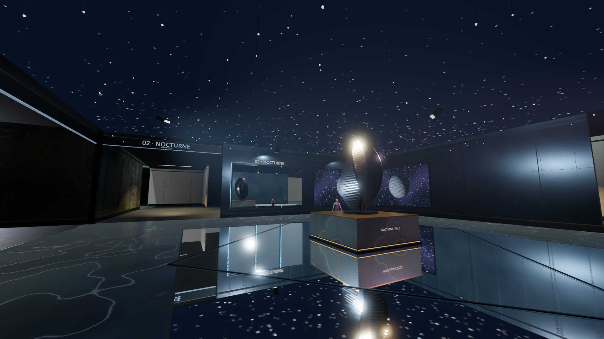

## 🎥 Video-Showcases auf YouTube

* **Teil 1: Labyrinth, Beleuchtung & Kunstgalerien:** [https://youtu.be/B02GJjcgpKk](https://youtu.be/B02GJjcgpKk)  
  *Vorstellung des 3-stöckigen Museums, SDFGI, Reflexionen und der thematischen Galerien.*
* **Teil 2: Flugterminal-Anbau & Rundflug in den Orbit:** [https://youtu.be/k2gzdX22JTw](https://youtu.be/k2gzdX22JTw)  
  *Der neue Flughafen, Einstieg in den Orbit Liner, Echtzeit-Raumflug und Einblicke in den iterativen KI-Workflow.*

> **Showcase-Hintergrund:** Entwickelt in nur **3–4 Stunden** mit der **Astra-KI** (GPT-4 Astra / Codex) und Godot 4.7.2 – ohne Vorkenntnisse in 3D-Grafikprogrammierung. Ausführliche Doku: [doc/PROJEKT_DOKUMENTATION.md](doc/PROJEKT_DOKUMENTATION.md) & [doc/HOMEPAGE_SHOWCASE_BLOG.md](doc/HOMEPAGE_SHOWCASE_BLOG.md).


## Windows-Download

Die startfertige Windows-x64-Demo gibt es unter
[GitHub Releases](https://github.com/tnickel/chroma-labyrinth/releases/latest).
Das Windows-ZIP vollständig entpacken und `Start-Chroma.bat` starten.
Godot ist enthalten; ein Editor, Python und Downloads beim Spielen sind nicht nötig.
Die Demo verwendet weiterhin Forward+ und benötigt eine Vulkan-fähige Grafikkarte.
Beim ersten Start werden Shader für die vorhandene Grafikkarte vorbereitet.
Bedienung und Lizenznachweise liegen im ZIP; die veröffentlichte SHA256-Datei
erlaubt den Vergleich mit dem heruntergeladenen Archiv.

## Aus dem Quellcode starten

1. Repository klonen oder als ZIP herunterladen und entpacken. Die Modelle sind enthalten; Git LFS ist nicht nötig.
2. [Godot 4.7.2](https://godotengine.org/download/archive/4.7.2-stable/) installieren. Die Demo wurde mit dem Build `4.7.2.stable.official.ed1daf0bf` und dem Vulkan-Renderer Forward+ geprüft.
3. `project.godot` im Editor öffnen und F5 drücken. Der erste Import erzeugt den lokalen `.godot`-Cache.

Unter Windows übernimmt `start.bat` Import und Start. Der Starter sucht der Reihe
nach nach `GODOT_EXE`, einer optionalen `start.local.bat`, einer Godot-EXE neben
dem Starter und `godot.exe`/`godot4.exe` im `PATH`. Eine lokale Konfiguration sieht so aus:

```bat
@echo off
set "GODOT_EXE=C:\Tools\Godot\Godot_v4.7.2-stable_win64_console.exe"
```

Diese zwei Zeilen als `start.local.bat` speichern; die Datei bleibt über
`.gitignore` privat. Unter Linux/macOS direkt im Godot-Editor starten oder
`godot --path .` ausführen. Die Engine selbst und generierte Caches sind nicht
Bestandteil des Repositorys. Quellen und Lizenzangaben der mitgelieferten Modelle
stehen in [assets/people/ASSET-LICENSES.md](assets/people/ASSET-LICENSES.md).
Die mitgelieferte Flughafen-Ausstattung hat eigene Quellenlisten:
[Materialien und HDR-Himmel](assets/airport/LICENSES.txt),
[glTF-Möbel](assets/airport/models/LICENSES.txt),
[Gelände](assets/airport/terrain/LICENSES.txt) und
[NASA-Erdkarten](assets/airport/EARTH-SOURCE.txt). Beim Spielen wird nichts heruntergeladen.
Der neue Boden verwendet [ambientCG-Terrazzo](assets/airport/terrazzo/source.json);
die Fluglandschaft ein [USDA/USGS-Luftbild](assets/airport/ground/SOURCE.txt).

### Windows-Release selbst bauen

Godot 4.7.2 und die passenden offiziellen Windows-x64-Exportvorlagen installieren,
die gewünschten Änderungen committen und aus einem sauberen Checkout ausführen:

```powershell
.\tools\build_release.ps1 -GodotExe 'C:\Tools\Godot\Godot_v4.7.2-stable_win64_console.exe' -Version '0.1.0'
```

Das Skript importiert und exportiert mit `export_presets.cfg`, prüft Fehler und
die erzeugten EXE/PCK-Dateien und legt ZIP, SHA256 sowie Build-Logs unter `build/`
ab. `BUILD-INFO.json` im Paket nennt den exakten Commit, die Engineversion und
Dateiprüfsummen. Tests, Werkzeuge, Screenshots und lokale Konfigurationen werden
nicht in die Spieldaten exportiert. Asset- und Engine-Lizenznachweise werden
separat beigelegt. Das Skript veröffentlicht selbst nichts.

Zur Abnahme das ZIP in einen eigenen Ordner entpacken und die native EXE dort
mit `--quit-after 240` starten. Die zusätzliche Ressourcenprüfung verwendet
den Godot-Editor derselben Version mit `--headless --main-pack <exportiertes-PCK>
--script <absoluter-Pfad-zu-Tests/PackagedDemoSmoke.gd>`. Sie prüft die tatsächlich
gepackten Assets und die vollständige Szeneninitialisierung. Die offizielle
Release-EXE unterstützt diese externen Skriptüberschreibungen nicht; ihr Start
wird deshalb separat geprüft.

Der Grundriss hat **50 % mehr Fläche** als die ursprüngliche Demo: rund
**80,83 × 80,83 m** statt 66 × 66 m, entsprechend **6.534 m²** statt 4.356 m²
Grundfläche. Länge und Breite wachsen dafür jeweils um den Faktor √1,5.
Die Hallen sind jetzt etwa 22,05 × 22,05 m groß. Drei Etagen, sechs Meter
Geschossabstand, Figurengröße und Laufgeschwindigkeit bleiben erhalten.

## Steuerung

- **W/A/S/D:** laufen; **Umschalt:** sprinten; **Leertaste:** springen
- **Maus:** umsehen; **F:** Taschenlampe an/aus
- **Esc:** Maus freigeben; **Linksklick:** Maus wieder einfangen
- **F3:** Bildratenanzeige ein-/ausblenden
- **Tab:** Welt-Auswahl öffnen/schließen; dort **1–9**, **0**, **U**, **M** oder eine Karte wählen
- **H:** HUD und Minimap für eine freie Ansicht ein-/ausblenden
- **F11:** Vollbild ein-/ausschalten
- **Im Flugzeug:** **V** Ziel Mond/Mars wählen, **R** Flug starten oder **T** Marsflug direkt starten; **Tab + ←/→** Flugphase wechseln; **B** nach der Landung Basis betreten/verlassen; **E** Fensterplatz/Aufstehen oder an der Basisschleuse Oberfläche betreten; **L** vorzeitige Rückkehr; **M** Fluggeräusch stummschalten
- **Während des Marsflugs:** **+ / −** schalten das Reisetempo zwischen **1×, 2×, 4× und 8×** um, auch am Ziffernblock. Das Flugdisplay zeigt Faktor und verbleibende Echtzeit. Ein neuer Flug beginnt mit 1×; beim Basisbesuch bleibt die Flugzeit pausiert.

Die Welt-Auswahl setzt den Spieler mit einer kurzen Überblendung an einen
geprüften Aussichtspunkt im echten Labyrinth. Von dort ist jeder Bereich frei
begehbar. Beim normalen Erkunden kündigen zurückhaltende Titel die Räume an.

Die Minimap unten links ist nordfest; der Pfeil zeigt die Blickrichtung. Auf Rampen wechselt sie am Mittelpunkt zwischen den Etagen. Die Rampen liegen an den beiden äußeren Rändern bei Z ≈ −36,74 und Z ≈ +36,74; ihr unterer Zugang befindet sich jeweils beim westlichen Rand. Ihre horizontale Länge beträgt jetzt 22,05 m bei sechs Metern Höhenunterschied (etwa 15,23° Steigung).

Die Bodenpfeile zeigen tatsächlich begehbare Routen: **Cyan führt aufwärts,
Amber abwärts**. An Abzweigungen stehen Ziel-Etage und verbleibende Weglänge;
die Entfernung folgt dem Labyrinthweg, nicht der Luftlinie. Direkt an den Rampen
stehen zusätzliche Etagen-Schilder. Im mittleren Stockwerk sind Auf- und Abstieg
getrennt markiert.

## Airport / Chroma Orbit

Im Erdgeschoss führt die neue **Ostachse vom Atrium** zu einem ausgeschilderten
Flughafenportal. Der Glasgang, die Wartehalle, die Fluggastbrücke und die Maschine
sind tatsächlich begehbar. Alternativ führt **Tab → AIRPORT** direkt ins Terminal.
Die Abflugtafel und Bodenmarkierungen weisen zu **Gate A01**; zurück geht es
über die Schilder **CHROMA / GALERIEN**. Die ursprüngliche Labyrinthfläche bleibt
erhalten; Terminal und Vorfeld liegen als zusätzlicher Anbau daneben.

Durch die Panoramafenster sind Landebahn, Hangars und drei Flugzeuge mit
Start-, Lande- und Rollbewegungen zu sehen. Die eigene Maschine besitzt
36 Sitze, 18 nutzbare Fensterplätze, einen Mittelgang, Gepäckfächer, Flügel,
Triebwerke und eine schließbare Einstiegstür. Die Fenster sind echte Öffnungen
mit transparentem Glas, keine Bilder an einer geschlossenen Wand.

Die überarbeitete Ausstattung verwendet mitgelieferte PBR-Texturen für Stein,
Leder, Gewebe, Holz, Beton und Asphalt sowie einen fotografischen HDR-Himmel.
Rauheit und feine Normalmaps reagieren auf das Licht; Holzlamellen, Fensterfalze,
Dichtungen, gerundete Polster, Nähte und Armaturen geben den Oberflächen Volumen.
Die Lounge ergänzt texturierte glTF-Sessel, Tische und Topfpflanzen.
Tiefe Akustikkassetten, gefasste Servicebereiche und gerahmte Anzeigen gliedern
die Wartehalle. Zwei lokale SDFGI-Kaskaden liefern indirektes Licht; Lampen
werfen Schatten unter Möbeln und hinter Sitzen. Beim Verlassen des Flughafens
wird dessen Beitrag zur indirekten Beleuchtung deaktiviert.
Die Kabine hat konturierte Sitzpolster, geneigte dünne Rückenschalen,
gekrümmte Seitenverkleidung und einzelne gewölbte Gepäckfachklappen.
Das Vorfeld geht in zusammenhängende, texturierte Hügel mit glatten Normalen über.
Die eigenen Flügel haben gewölbte Profile, getrennte Steuerflächen und gebogene
Flügelspitzen. Kabinenlampen und Flugsonne bleiben auch für die isolierte
Flugkamera sichtbar; Empfänger- und Kamera-Lichtmasken werden getrennt gesetzt.
Quellen und Nutzungsbedingungen stehen unter `assets/airport/`.

**22 zusätzliche Menschen** beleben den Flughafen: sechs gehen zwischen Eingang,
Gate und Aussicht umher, sechs warten sitzend, vier sind bereits in der Maschine
und sechs steigen zeitversetzt ein. Das Boarding führt über die tatsächliche
Brücke und den Mittelgang zu reservierten Innensitzen. Die vorhandene
`Sit_Stand`-Animation wird an die Sitzhöhe angepasst; Hände ruhen auf dem Schoß.
Nach der Landung steigen einige wieder aus. Die 18 Fensterplätze bleiben für
den Spieler verfügbar. Bei besetztem Türbereich wartet der Abflug auf einen
freien Durchgang. Außerhalb der Reichweite schlafen Bewegung und Animation;
entferntere sichtbare Posen laufen reduziert mit zehn Aktualisierungen pro Sekunde.
Stoffgewebe und Falten-Normalmaps verwenden ihre jeweils richtigen UV-Skalen;
mehrere zurückhaltende Kleidungsfarben reduzieren sichtbare Wiederholungen.
Haut und Stoff reflektieren weniger stark. Die vier vorhandenen Menschenmodelle
bleiben erkennbar vereinfacht; neue gescannte Personen sind nicht enthalten.

Ein **1,90 × 18 m großes Glasdach**, ein **2 × 1,6 m großes Bodenfenster** im
vorderen Kabinenbereich und ein **0,86 × 16,8 m langer Glasgang** erlauben den
Blick nach oben und unten. Die Rumpfhülle ist dort wirklich geöffnet; das
Bodenglas bleibt begehbar. Das ist ein gestaltetes Panorama-Flugzeug, kein
Nachbau einer zugelassenen Verkehrsmaschine.

Am **Heck** führt der Mittelgang jetzt durch einen zwei Meter breiten Zugang
in eine **kugelförmige 360°-Panoramakuppel**. Die Kugel misst außen 9,6 m;
der begehbare Glasboden hat knapp 8,90 m Durchmesser. Auch die untere Kugelhälfte
ist transparent: Landschaft, Wolken und Erde bleiben unter den Füßen sichtbar.
Sechs gerundete Tragprofile, ein umlaufender Deckring, Dichtungen und ein Dachring
fassen den Rundumblick. Der Anschluss zum Flugzeug bleibt ein tatsächlich offener Gang. Zwei seitliche Leitwerksfinnen
ersetzen das mittige Heckleitwerk. Die Kuppel ist am Gate und während des Fluges
frei begehbar; ihre Glashülle verhindert, dass man hinausfällt.

Die Außenkonstruktion wurde nochmals überarbeitet: Eine durchgehende, glatt
schattierte Rumpfhaut besitzt echte ovale Fensteröffnungen mit bündigen Rändern.
Die längere Nase geht vom Kabinenprofil in einen elliptischen Bug über; die
Cockpitscheiben folgen seiner Wölbung. Eine geformte Heckverkleidung reicht
lückenlos bis zum Kuppelanschluss und enthält den gerundeten Durchgang.

Tragflächen und beide Heckleitwerke sind geschlossene, profilierte Volumen mit
geformten Wurzeln und gebogenen Winglets. Die beiden Triebwerke besitzen hohle
Einläufe, gerundete Lippen, jeweils 22 geschwungene Fanblätter, Spinner, Pylone
und Auslässe. Runde Reifen, Naben und Federbeine ersetzen die einfachen Scheiben.
Lack, Metall, Dichtungen und Glas sind getrennte PBR-Materialien; dezente
Mikrorauheit, ein aufliegender Farbstreifen und die Aurora-Beschriftung ergänzen
die Oberflächen. Das Vorfeld verwendet fotografischen warmgrauen CC0-Beton von
Poly Haven (`concrete_tiles_02`, 2K mit Normal- und Roughness-Map). Er ersetzt
die vorherige rostbraune Textur und ihre starke indirekte Rotfärbung am Rumpf.
Die Module erzeugen statische Geometrie einmal beim Aufbau;
es gibt dafür keine neue Berechnung pro Frame oder zusätzliche Spiegelkamera.
Die Konstruktion ist weiterhin eine gestaltete Spezialmaschine, keine
flugmechanisch oder strukturell validierte Flugzeugentwicklung.

1. Über Gate A01 und die Glasbrücke in die Maschine gehen.
2. Mit **E** neben einer Sitzreihe einen Fensterplatz einnehmen.
3. **R** drücken oder nach **Esc** den Button **MONDREISE STARTEN** anklicken.
   Der Start ist nur an Bord möglich und setzt den Spieler nötigenfalls an
   einen Fensterplatz. **In der Heckkuppel startet R den Flug direkt im Stehen**;
   Position und freie Bewegung bleiben erhalten. Der Mausblick bleibt frei.
4. Die **14:07 Minuten** lange Reise führt über Start, Wolken und Erdorbit zum
   Mond, über die Copernicus-Region zur Landung an der Basis und nach dem
   Erdaufgang zurück zum Gate. **E** erlaubt auch währenddessen das Aufstehen
   und Gehen in der geschlossenen Kabine. Die Zeit für den Basisbesuch kommt hinzu.
5. Nach dem Andocken öffnet die Tür. Mit **E** aufstehen und denselben Weg durch
   Brücke und Terminal zurück ins Labyrinth gehen. Weitere Flüge sind möglich.

**L** leitet ab der Wolkenreise eine vorzeitige Rückkehr ein. Auch am Mond beginnt
sie an der aktuellen Position der Außenwelt und führt über Rückflug, Wiedereintritt
und Landung zurück. Der Fortschritt richtet sich nach der verbleibenden Reisezeit.
Das Flugdisplay nennt die aktuelle Phase und empfiehlt passende Blickrichtungen.
Für die Mondoberfläche besonders geeignet: in der Heckkuppel durch den Glasboden
schauen, für Erdaufgang und Anflug zum Heck sehen, für Sterne nach oben schauen.

### Mondreise und echte Bilddaten

Die Mondansicht verwendet Bild- und Höhendaten der Lunar Reconnaissance Orbiter
Mission, einschließlich einer regionalen Detailkarte für den nahen Überflug.
Die globale Farbkarte hat 16.384 × 8.192 Pixel. Eine WAC-Aufnahme deckt rund
485 × 485 km um Copernicus mit etwa 118 m pro Pixel ab; der nahe NAC-Ausschnitt
hat 4.951 × 8.192 Pixel und rund 6,84 m pro Pixel aus 5-m-Quelldaten.
Die feinen Stereo-Höhen gelten im tatsächlich gemessenen Streifen; außerhalb
liefern die gröberen LOLA-Messungen das Gelände. Die Karten werden räumlich
ineinander überblendet und behalten ihre dokumentierten geografischen Grenzen.
Der lange Kraterüberflug senkt sich von 15 auf fünf Kilometer Höhe und steigt
anschließend für den Erdaufgang wieder an (Höhen relativ zur Mond-Referenzkugel).
Dazwischen liegt die modellierte Mondbasis: Die Reise zeigt zunächst den Anflug
und Nahüberflug, anschließend den Abstieg zum Landeplatz, den Aufenthalt am
Boden und den Wiederaufstieg.
Relief, wechselnde Perspektive und
gerichtetes Sonnenlicht ergänzen die fotografische Oberfläche. Beim Anflug
wächst der Mond kontinuierlich, während die Erde auf der Rückreise größer wird.
Der Sternhimmel stammt aus der NASA-Karte **Deep Star Maps 2020**, die auf
astronomischen Sternkatalogen beruht; die frühere zufällige Sternverteilung entfällt.

Die Quelldaten, Bildverarbeitung, Auflösungen und Nutzungsbedingungen sind in
[assets/space/SOURCE.json](assets/space/SOURCE.json) und
[assets/space/LICENSES.txt](assets/space/LICENSES.txt) dokumentiert.
Alle fertigen Ressourcen werden mitgeliefert; während des Flugs erfolgt kein
Download. Flugzeiten, Route, Beleuchtung und Belichtung sind für die Erlebnisreise
gestaltet. Die Demo bildet keine aktuelle astronomische Konstellation oder
physikalisch mögliche Reisegeschwindigkeit eines Verkehrsflugzeugs nach.

`scripts/airport/LunarFlightPlan.gd` enthält den von der Grafik getrennten
Reiseverlauf. `Tests/LunarFlightRegression.gd` prüft Übergänge und Rückreisen.
Während des Flugs springt **Tab + Pfeiltaste** direkt in die nächste bzw.
vorherige der 21 Phasen (rundum); der Spieler bleibt sitzen bzw. stehen und ein
begonnener vorzeitiger Rückflug wird beim Sprung verworfen. Zwischen
Kraterüberflug und Erdaufgang liegen fünf Mondbasis-Phasen. Die Siedlung auf
dem Copernicus-Hang ist ein gestaltetes 3D-Modell mit Habitatmodulen,
Gewächshauskuppel, Solarfeldern und Landeplattformen. Der Standort verwendet
gemessene Mondhöhen; die kleinskaligen Boden- und Felsdetails verwenden
irdische Mondsimulant-Scans und sind keine Mondfotografien
(`assets/space/lunar_analog/SOURCE.json`; ältere Bodentextur:
`assets/space/base/regolith/SOURCE.json`).
Außenhabitate verwenden ein für die fiktive Bodenstation angepasstes
Gateway-iHAB-Modell; die Rover basieren auf einem NASA-Entwurf. Herkunft und
Verarbeitung stehen in `assets/space/base/models/gateway_SOURCE.json` und
`assets/space/base/models/nasa_sev_SOURCE.json`.
Nach dem Aufsetzen öffnet **B** den Innenbesuch. Ein Szenenwechsel bringt den
Besucher in die begehbaren Räume mit Schleuse, Korridor, Messe, Gewächshaus,
Labor, Kontrollraum und Aussichtskuppel. An der markierten Außenschleuse
wechselt **E** mit einer kurzen Abblendung zum begehbaren Mondgelände und an
derselben Schleuse wieder zurück. Der Außenbereich hat Geländekollision,
geringere Mondschwerkraft und einen begrenzten Erkundungsradius von etwa
620 m um die Station. Die Flugzeit pausiert während des gesamten Besuchs;
**B** führt an den vorherigen Platz in der Kabine zurück; **Esc** gibt die Maus frei. Kabine,
Innenraum und Mondoberfläche sind dabei getrennte Szenenbereiche, nicht ein
durchgehend begehbarer Weg zwischen Raumfahrzeug und Innenmodell. Während des
Außengangs steht eine szenisch angepasste Apollo-basierte Fährenhülle auf dem
Besucherpad; sie ist nicht die tatsächliche äußere Geometrie der Flugkabine.
Gerahmte Raumfahrt- und Astronomiebilder mit Credits hängen in den Räumen;
Herkunft und Nutzungsbedingungen stehen in
`assets/space/interior/art/image-sources.json`.

### Marsflug und Marsbasis

Die Welt-Auswahl bietet direkte Einstiege in **Marsflug** (0), **Mars-Überflug**
(U) und **Marsbasis** (M). Alternativ im Flugzeug mit **V** Mars als Ziel wählen
und mit **R** starten; **T** startet dort ebenfalls den Marsflug. Die Heckkuppel
zeigt Erde und Mars als beleuchtete Kugeln mit fotografischen Oberflächenkarten
vor dem katalogbasierten NASA-Sternhimmel. Große Archivbilder werden auf Hin-
und Rückflug nicht mehr automatisch vor die Fenster projiziert. Der zeitlich
und räumlich verkürzte Erlebnisflug ist keine berechnete interplanetare Flugbahn;
Jupiter und Saturn liegen nicht als nahe Zwischenstationen auf dieser Route.
Die mitgelieferten Webb- und Cassini-Archivbilder bleiben als getrennt aktivierbare
Präsentation im Projekt erhalten. Die Infrarotdaten des Webb-Bilds sind in
sichtbare Farben übersetzt. Bildquellen und Nutzungsbedingungen stehen in
[`assets/space/observatory/SOURCE.json`](assets/space/observatory/SOURCE.json)
und [`assets/space/observatory/LICENSES.txt`](assets/space/observatory/LICENSES.txt).
Die Bilder liegen lokal vor; eine Internetverbindung ist beim Spielen nicht nötig.

Der Marsanflug richtet die Maschine über einer freien Landefläche aus und lässt
sie nach dem Aufsetzen ausrollen. Gelände, Berge und Flugzeug verwenden dabei
denselben Marsbezug. Kontrollaufnahmen und Prüfungen stehen in
[`doc/mars-flight/validation.md`](doc/mars-flight/validation.md).

Die Marsbasis ist eine fiktive Gestaltung mit begehbaren Räumen, Kuppeln und
Oberfläche. Der Boden und die Canyons sind aus Texturen und Geometrie gestaltet,
keine fotografisch genaue Rekonstruktion eines Mars-Landeplatzes. **E** wechselt
an der Schleuse zwischen Innen- und Außenbereich, **B** kehrt zur Fähre zurück.
In der **südöstlichen Kuppel** führt ein ausgeschilderter Glasgang zum Aufzug
des Aussichtsturms. **E** am Aufzug fährt nach oben oder zurück. In der oberen
Glaskuppel lässt sich das Panorama mit dem **Mausrad** vergrößern; beim Verlassen
wird die normale Kamerasicht wiederhergestellt. Der begehbare Innenbereich und
die außen sichtbare Turmkuppel sind getrennt gestaltete Szenenbereiche.

Dort umgibt ein echtes [Curiosity-Mastcam-Panorama vom Gediz-Vallis-Kanal](https://science.nasa.gov/photojournal/curiosity-takes-a-360-degree-view-of-gediz-vallis-channel/)
den Aussichtspunkt. NASA setzte es 2024 aus 336 Einzelbildern zusammen und passte
die Farben an irdische Beleuchtung an. Es ist eine historische Aufnahme, kein
Livebild und kein Foto vom Standort der fiktiven Station. Die leeren Ränder des
Originalmosaiks werden durch Randfarben überblendet; die dargestellten Rovermodelle
der Station sind zusätzliche 3D-Modelle. Details zur Quelle, Bildaufbereitung und
zum Offline-Betrieb stehen in [`assets/space/mars_observation/SOURCE.json`](assets/space/mars_observation/SOURCE.json).
`tools/lunar_review.gd` erstellt Forward+-Aufnahmen aus der echten Kabine und
Kuppel sowie Messungen mit laufenden Passagieren und normalem Flugdisplay.
Der geprüfte Stand und seine Grenzen stehen in
[doc/lunar/validation.txt](doc/lunar/validation.txt).

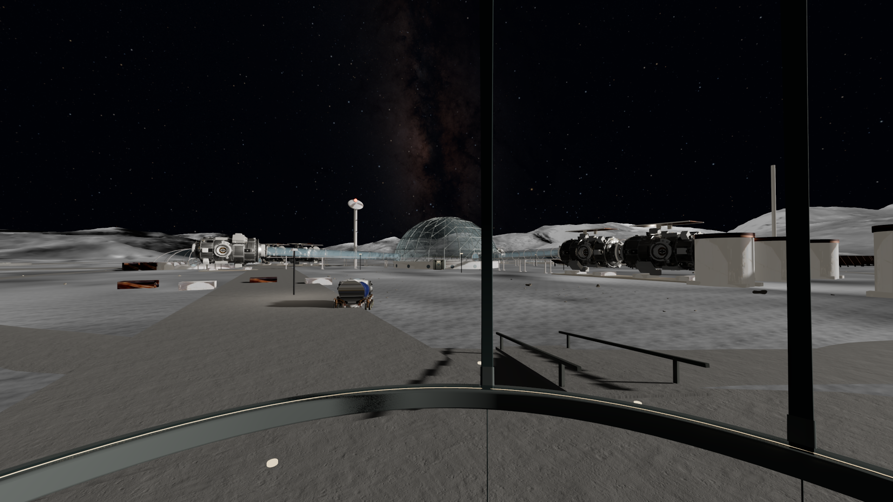
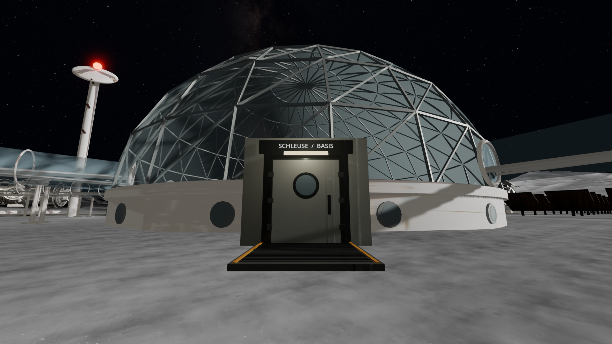
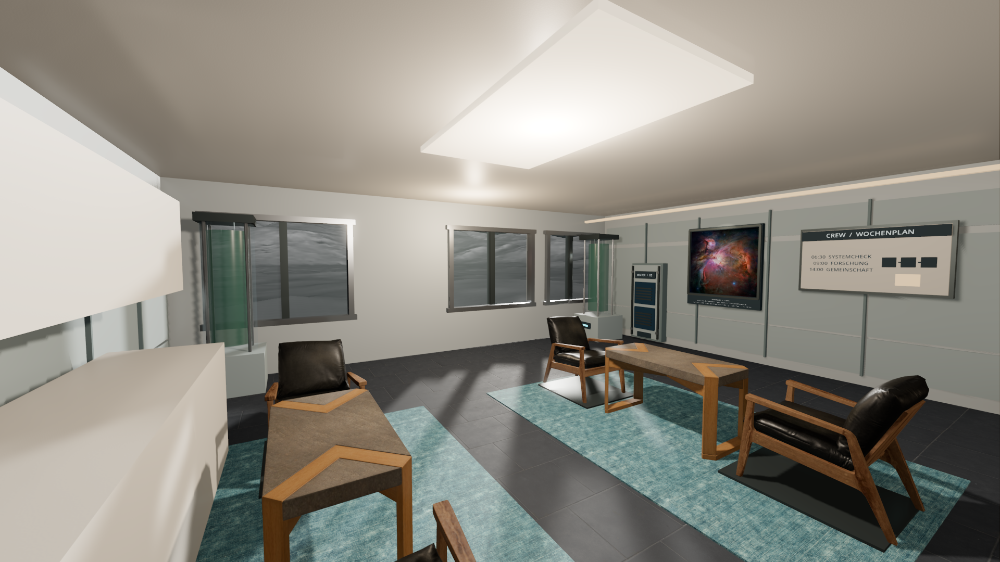
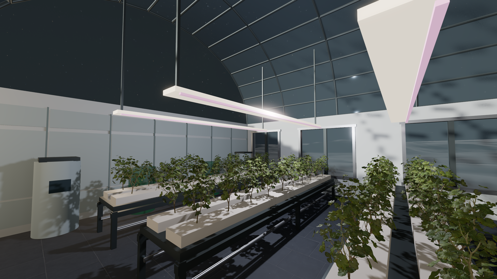
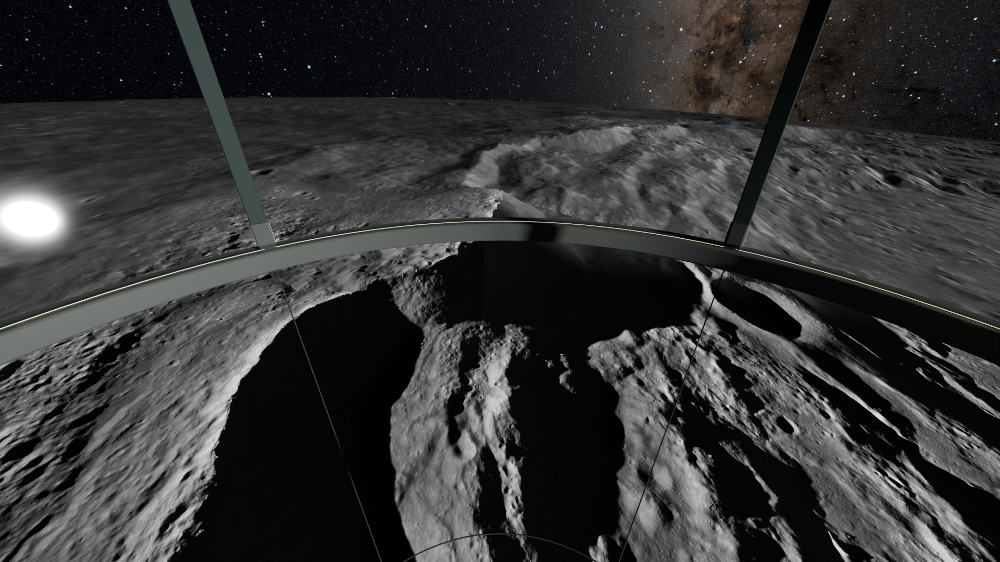
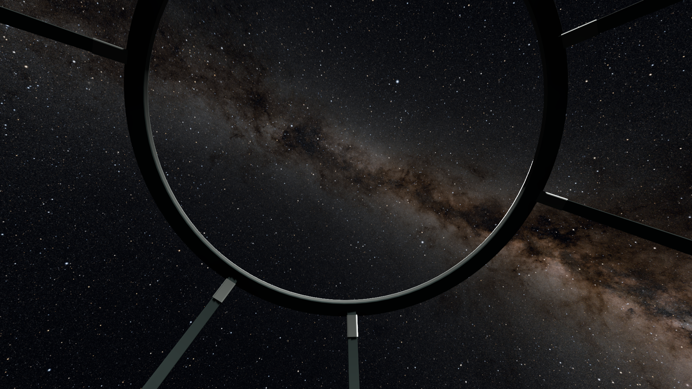

Das ist ein inszenierter Passagier-Erlebnisflug: Ein gewöhnliches Verkehrsflugzeug
fliegt nicht ins All. Die Kabine behält stabile Physikkoordinaten; bewegte
Landschaft, räumliche Wolken, Himmel und gekrümmter Planet erzeugen das
Panorama. In Bodennähe ersetzt eine echte USDA/USGS-NAIP-Luftaufnahme aus
Lancaster County (2022, 4000² Pixel, etwa 1,7 m/Pixel) die früheren Farbfelder.
Sie ist eine amerikanische Landschaftskulisse und wird gespiegelt wiederholt;
der Übergang zum Mittelmeer ist eine Inszenierung, keine geografisch konsistente Route.
Die Erdoberfläche verwendet eine statische NASA-GIBS-Region des
Mittelmeerraums mit 8192² Pixeln und etwa 500 m Rasterweite. Außerhalb dieses
Ausschnitts dient das globale Blue-Marble-Komposit vom Juli 2004 als Fallback.
Atmosphäre, Wolken und Reiseverlauf sind inszeniert und keine Live-Daten.
Die Wolkenreise kombiniert den fotografischen Himmel mit zwei volumetrischen
Wolkenbändern. Ein Tiefenpuffer-bewusster Raymarch durch eine gemeinsame
3D-Rauschtextur erzeugt Parallaxe und Eigenverschattung. Im Orbitalabschnitt
wird dieser Pass abgeschaltet; auch die Reflexionen wechseln zum Nachthimmel.
Leises Triebwerksrauschen und ein Kabinensignal entstehen ebenfalls im Code.
Während des Fluges bleibt die Weltenauswahl gesperrt, bis das ursprüngliche
Gate samt Kamera, Umgebung, Licht und Steuerung wiederhergestellt ist.

Das vollständige Konzept steht in [doc/Flugterminal-Konzept.txt](doc/Flugterminal-Konzept.txt).
Module: `scripts/airport/`; Außenwelt- und Terminal-Shader: `shaders/airport_*.gdshader`.
`Tests/AirportRegression.gd` prüft den realen Hin-/Rückweg mit der Player-Kapsel,
E/R/L/Tab-Eingaben, alle Flugphasen, zwei Flüge und die vollständige Rückkehr.
Der Abschlusslauf mit Heckkuppel bestand 9.107 Prüfungen mit 1.448 Wegproben. Zusätzlich sind
Flugstart während eines Weltwechsels und die Sitzsperre beim Menüschließen
abgedeckt. Die Weltenauswahl bestand weitere 3.278 Prüfungen mit acht Zielen.
`Tests/AircraftPanoramaRegression.gd` bestand 459 Prüfungen echter Mesh-Dreiecke
entlang der Sichtstrahlen sowie der Glaskollisionen, Fensterfugen und Sitzanker.
`Tests/AircraftSeatingRegression.gd` prüft zusätzlich Sitzkontur, Schalenstärke
und Lehnenneigung sowie Fensterkanten und Gepäckfachklappen: 72 Prüfungen bestanden.
`Tests/AirportLightingRegression.gd` bestand 68 Prüfungen des GI-Beitrags,
der Fluglichtmasken und der Wiederherstellung der Museumsbeleuchtung.
`Tests/AirportPassengersRegression.gd` prüft Boarding, Rückkehr, Sitzhaltung,
Vorwärtsgehen, Render-Layer und das Schlafen entfernter Passagiere: 11.598 Prüfungen,
2.892 Wegproben, neun abgeschlossene Boardings und drei Rückkehrer ohne Fehler.
`tools/airport_light_probe.gd` vergleicht tatsächliche Kabinenbilder mit den
Produktions-Lichtmasken und absichtlich ausgeblendeten Lampen; dadurch wird der
behobene Fehler der Flugbeleuchtung auch optisch geprüft.
`tools/airport_review.gd` erzeugt echte Forward+-Aufnahmen; `tools/airport_benchmark.gd`
misst die laufende Hauptszene mit normalem HUD, Besuchern und Flugverkehr.
`Tests/AircraftDomeRegression.gd` prüft den neuen Heckzugang mit der echten
Spielerkapsel, 144 Bodenproben, die geschlossene Glashülle, Sichtstrahlen durch
reale Meshes und den stehenden Rundflug samt Rückkehr: 1.519 Prüfungen bestanden.
Die anschließende sichtbare Schottkorrektur wurde zusätzlich durch den kompletten
GPU-Rundgang mit Flug, Landung und Rückweg geprüft.
`tools/airport_dome_review.gd` läuft per Spielerphysik hinein und wieder hinaus;
es zeigt die Kuppel am Gate, im Wolkenflug, in sechs Orbitalrichtungen und von außen.
`tools/airport_dome_benchmark.gd` misst vier Kuppelansichten und die gesamte
Maschine von außen. `--exterior-only` beim Dome-Review erzeugt acht Außenansichten
mit dokumentierter Kameraposition, darunter Nase, Fenster, Triebwerk und Anschluss.
`Tests/AircraftExteriorRegression.gd` prüft echte Dreiecke, Wicklung, Normalen,
geschlossene Volumen und die freien Fensteröffnungen: 1.202 Prüfungen bestanden,
darunter 216 Fensterfeld-Eckstrahlen und 162 Strahlen durch freie Fenster.
Die komplette Prüfserie und
gezielte Nachtests stehen in `doc/airport/aircraft-redesign-validation.txt`.
`Tests/AirportTerminalGeometryRegression.gd` prüft Endkappen, Länge und Radius
schräger Terminalstreben: 65 Prüfungen, einschließlich einer zuvor durch das
Dach ragenden Strebe. `tools/aircraft_finish_probe.gd` trennt SSR, Reflexionen,
SDFGI und SSIL in kontrollierten Render-Vergleichen; die Produktionsdarstellung
behält diese Effekte bei.

Forward+-Aufnahmen aus der tatsächlichen Hauptszene:

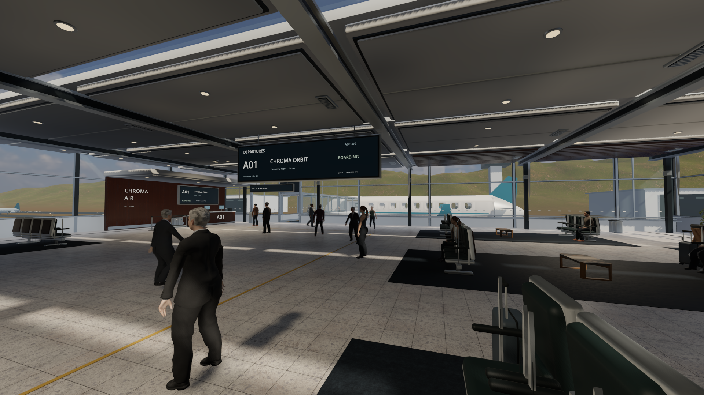
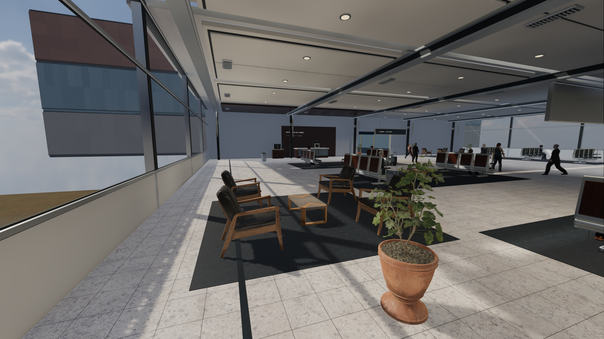
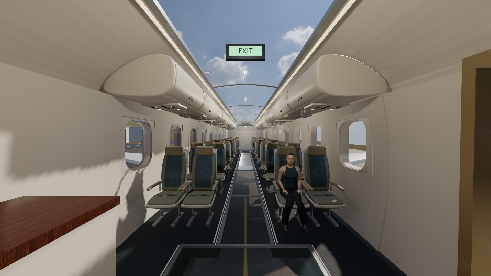
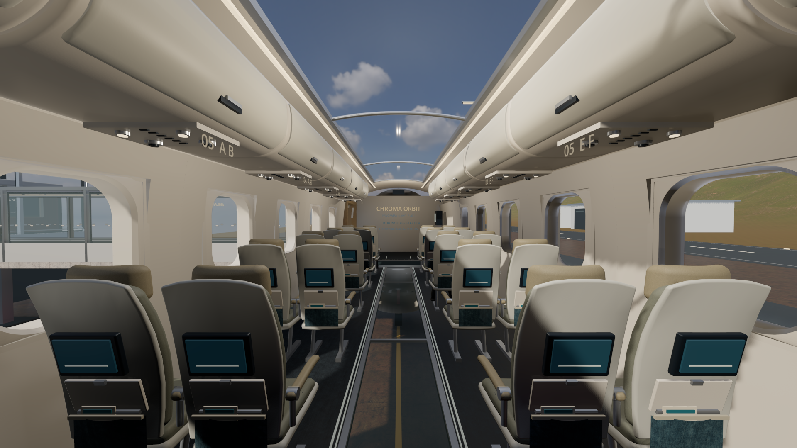
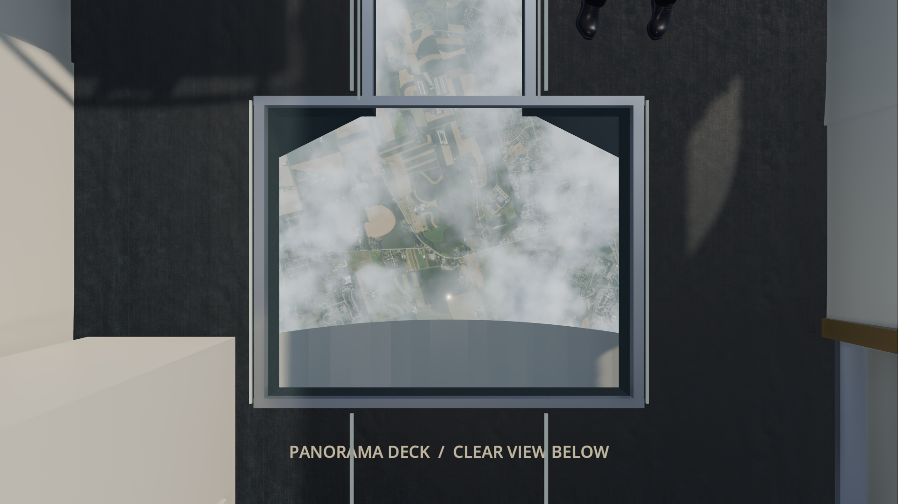
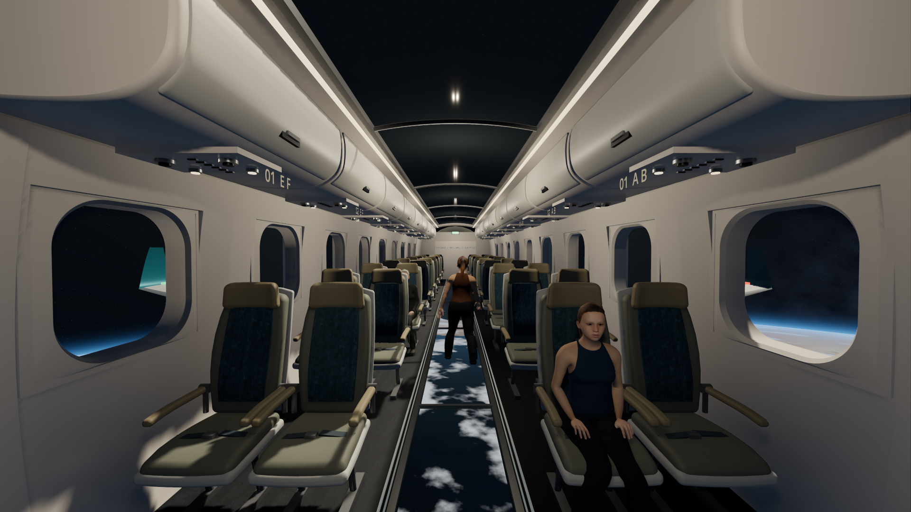
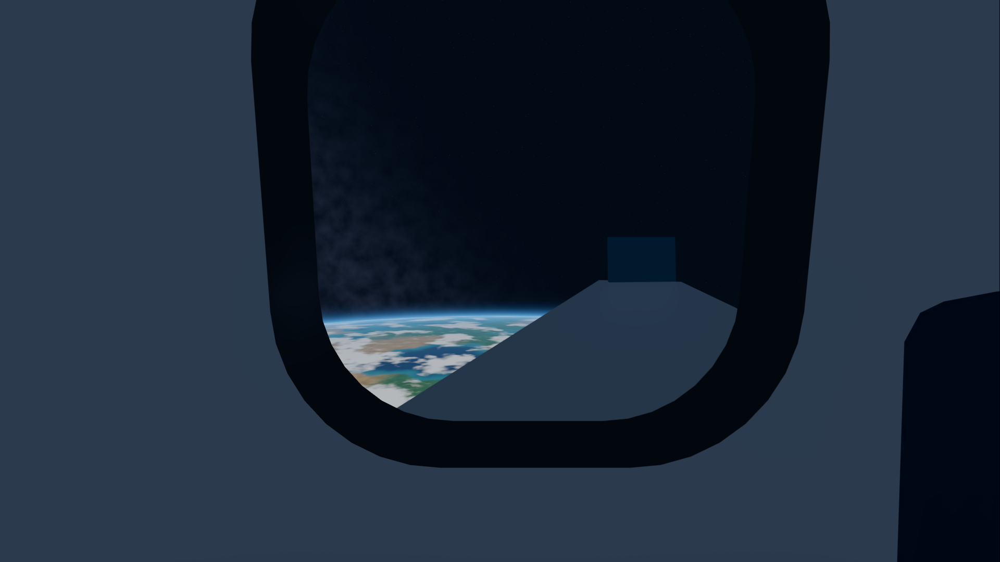
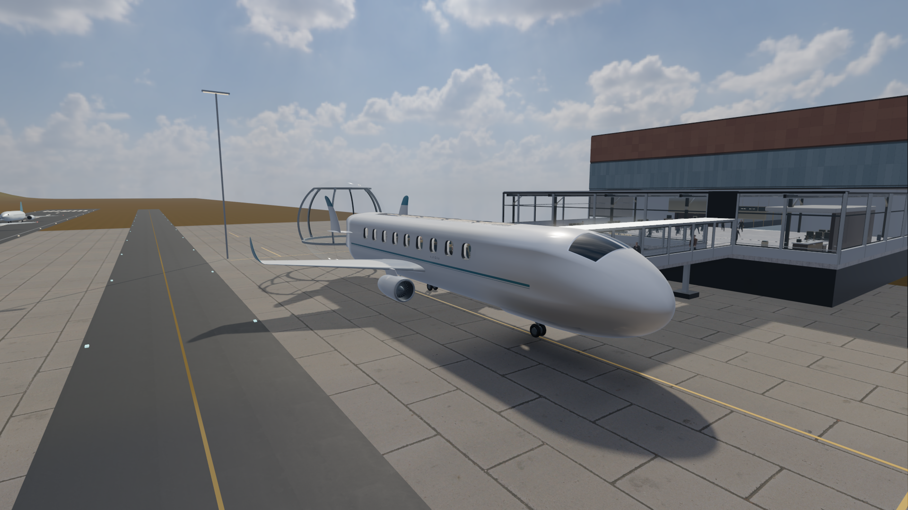
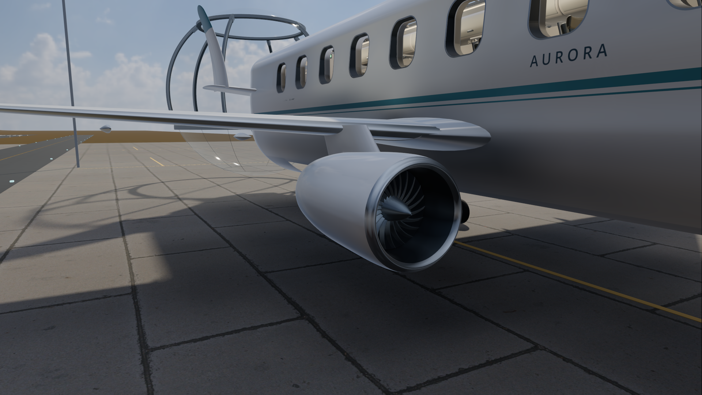
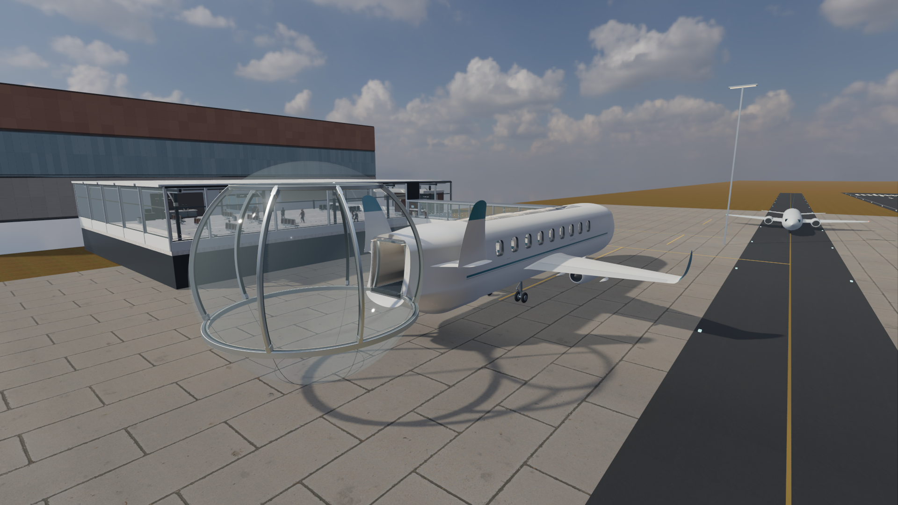
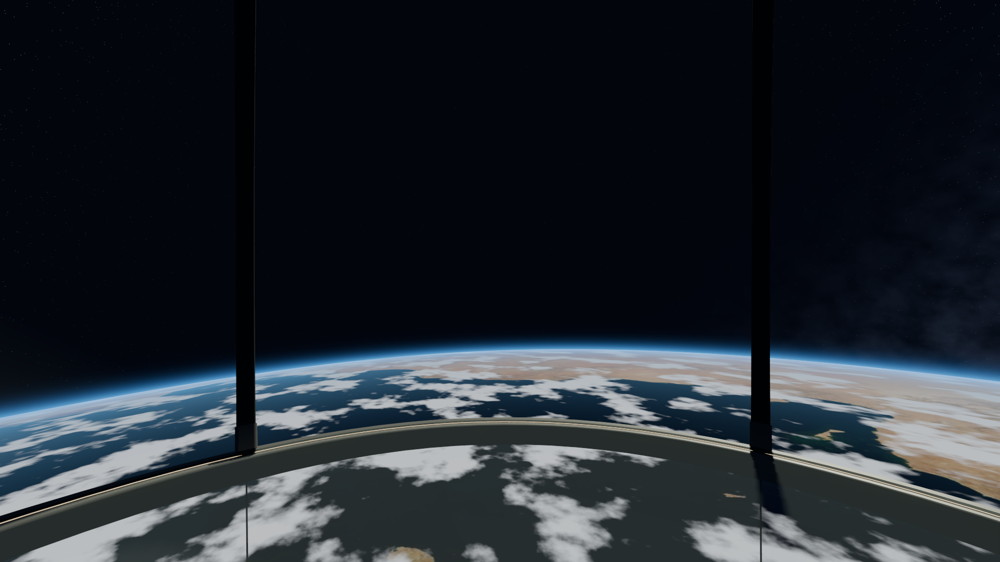

Leistungsstichprobe **vor dem Anbau der Heckkuppel**, mit der überarbeiteten Architektur und Kabine, SDFGI,
schattenwerfenden Leuchten, Passagieren, Luftbild und volumetrischen Wolken vom 29.10.2026,
RTX 4070, Godot 4.7.2, 1920×1080,
ohne VSync und ohne parallele Lasttests. Je Ansicht 2,5 Sekunden Aufwärmzeit
und drei Sekunden Messung, normale Besucher-/Verkehrslogik und HUD aktiv:

| Ansicht mit Flughafen-Erweiterung | Median pro Bild | 95. Perzentil | FPS aus dem Median |
| --- | ---: | ---: | ---: |
| Atrium | 10,04 ms | 16,02 ms | 100 |
| Terminal mit Flugverkehr | 5,70 ms | 8,78 ms | 175 |
| Lounge mit glTF-Möbeln | 5,28 ms | 8,74 ms | 189 |
| Kabine am Gate | 4,47 ms | 5,80 ms | 224 |
| Start, Blick aus dem Fenster | 4,17 ms | 9,49 ms | 240 |
| Wolkenreise, Blick aus dem Fenster | 4,40 ms | 11,89 ms | 227 |
| Orbitalpanorama, Blick aus dem Fenster | 2,39 ms | 10,85 ms | 419 |
| Kabineninnenraum im Orbit | 3,93 ms | 11,31 ms | 254 |
| Glasboden mit Satellitenkarte | 3,34 ms | 6,16 ms | 299 |
| Volle Kabine, zehn Passagiere (gezielter Lastfall) | 4,60 ms | 13,94 ms | 218 |

Im Terminal waren alle 22 Flughafenpersonen aktiv, im Atrium keine; während
der normalen Flugmessungen waren fünf Personen an Bord aktiv. Der übrige
Terminalverkehr schlief. Für den zusätzlichen Lastfall setzt das Messtool alle
sechs Boarder direkt in ihre reservierten Sitze: zehn aktive Kabinenpassagiere.
Das ist eine ausdrücklich vorbereitete Leistungsprobe; der normale Einstieg
läuft weiterhin über die Brücke und wird separat als Wegablauf geprüft.
Rohdaten einschließlich aktiver Personen,
Drawcalls und Flugzustand stehen in `doc/airport/airport_benchmark_1920x1080.json`.

Messung vom **30.10.2026 mit überarbeiteter Außenkonstruktion und Heckkuppel**,
RTX 4070, Godot 4.7.2, 1920×1080, ohne VSync und parallele Lasttests,
normalem HUD und regulärer Passagierlogik. Je Blick mindestens 2,5 Sekunden und
120 Frames Aufwärmzeit nach dem ersten Bild, anschließend drei Sekunden Messung:

| Ansicht | Median pro Bild | 95. Perzentil | FPS aus dem Median |
| --- | ---: | ---: | ---: |
| Am Gate auf das Vorfeld | 3,04 ms | 3,66 ms | 329 |
| Ganze Maschine und Terminal von außen | 4,67 ms | 6,01 ms | 214 |
| Freies Wolkenpanorama | 7,21 ms | 7,72 ms | 139 |
| Freies Orbitalpanorama | 2,23 ms | 2,58 ms | 449 |
| Im Orbit zurück zur Kabine | 3,25 ms | 3,59 ms | 308 |

Der freie Wolkenblick beansprucht nahezu die ganze Bildfläche und ist deshalb
teurer als der Blick durch ein kleines Kabinenfenster. In den Flugmessungen
waren fünf reguläre Passagiere an Bord aktiv; am Gate waren 20 Flughafenpersonen
aktiv. Keine Personen wurden für diesen
Test versetzt. Details: `doc/airport/airport_dome_benchmark_1920x1080.json`.
Die Ansichten sind kurze Stichproben, keine zugesicherten Mindest-FPS. Der ältere
Kuppel-Messstand und das alte Außenbild liegen in `doc/airport/before-aircraft-redesign/`.

Die Flugansicht rendert nur die Kabine und ihre eigene Außenwelt. Die volumetrischen
Wolken benötigen einen zusätzlichen Renderpass mit bis zu 64 Schritten je
sichtbarem Außenpixel; opake Kabinenflächen und Flügel werden vorher ausgeschlossen.
Es handelt sich um gestaltete Wolkendichte ohne Wetterphysik. Diese kurzen Stichproben sind keine
Mindest-FPS-Zusage oder isolierte Messung des zusätzlichen Flughafenaufwands.
Unbearbeitete Bilder und Messdaten liegen in `doc/airport/`, vom Asset-Import
durch `.gdignore` ausgeschlossen.

## Die sechs Galerien

Die Architektur und Materialien dieser sechs Galerien entstehen im Code.
Diese Galerien benötigen keine externen Texturen oder Architekturmodelle. Die vorhandenen
Besuchermodelle bleiben mitgelieferte GLB-Dateien.

| Etage | Nordwestliche Halle | Südöstliche Halle |
| --- | --- | --- |
| 01 / OBSIDIAN | **SOLAR:** warme Sonnensegel, gerillter Kalkstein, Travertin und Messing | **NOCTURNE:** Sternenraum, Obsidian, kosmisches Wandfenster, echter Wandspiegel und 12 × 12 m perspektivischer Spiegelboden |
| 02 / GLACIER | **GLACIER:** spektral leuchtender Kristall, rotierende Strahlenfächer, Kaustik-Lichtkranz, Wasser-Lichtboden und schwebendes Eis | **SPECTRUM:** raumspannende prismatische Bänder, Terrazzo und kinetisches Möbiusband |
| 03 / EMBER | **EMBER:** Basaltgewölbe, langsam glühende Magmaadern und Kupfer | **AFTERGLOW:** fließende Aurorabänder, projizierter Lichtgarten und blaugrüner Stein |

Das Atrium verbindet die Etagen mit Glasbrüstungen, Stahlstützen, einem Glasdach
und dem **Engine of Light**: drei zwölf Meter hohe, GPU-animierte Metallsegel
um einen leuchtenden Kern. Eine reflektierende Bodenrosette greift seine Form auf.
Zwölf beschriftete Raumportale markieren die wichtigsten tatsächlichen Zugänge;
weitere Öffnungen behalten dezente Bodenschwellen. Die Rampen haben Glasgeländer und einen
verglasten äußeren Abschluss. In den Gängen hängen gerahmte, langsam animierte
Konturzeichnungen. Fugen, Metallprofile, eingelassene Bodenlinien und eigene
Leuchten geben der Architektur erkennbare Maßstäbe.

Die Beleuchtung setzt Raumakzente statt eines identischen Lampenrasters in jeder
Halle. Acht lokale Nebelvolumen unterstützen gerichtete Lichtschächte; der globale
Nebel bleibt schwach. AgX-Tonemapping erhält helle Lichtflächen, ohne die gesamte
Szene weiß aufzuhellen. Die Materialfamilien unterscheiden sich in Maserung,
Rauheit, Reflexion und Relief, nicht nur in ihrer Farbe.

### Glacier: Prismenresonanz

Über **Tab → GLACIER** lässt sich die Installation direkt besuchen. Die fünf
Kristalle tragen polierte Facetten mit wandernden Lichtadern und gegeneinander
versetzten Spektralfarben. Ein Farbkreis dauert rund 18 Sekunden; die Farben
gehen kontinuierlich ineinander über. Langsam rotierende Strahlenfächer,
ein mehrfarbiger Bodenlichtkranz und 96 schwebende Lichtpartikel ergänzen den Kern.
Drei synchronisierte Echtzeitlichter beleuchten den Sockel, Boden und Besucher.
Die Bodenmuster und Strahlen sind künstlerische Shader-Effekte, keine physikalisch
berechneten Lichtbrechungs-Kaustiken.

Die 60 ursprünglichen Kanten-Meshes wurden zu fünf zusammengefasst. Kristalle,
Sockel und Effekt benötigen zusammen 14 Mesh-Surfaces; die Partikel bewegen sich
gebündelt auf der GPU. Zusätzliche Lichter und Atmosphäre blenden zwischen 18 und
24 Metern aus und schalten auf anderen Etagen ab. Im inaktiven Zustand prüft das
Modul nur zehnmal pro Sekunde die Kamera und überträgt keine Animationsparameter.
Die echten Kristall-Meshes bleiben für Sichtbarkeit und Reflexionen bestehen.
Die vorhandenen statischen Cubemaps werden weiterhin einmal aufgenommen;
laufende Farbänderungen erscheinen dort nicht zeitlich korrekt. SSR und direkte
Beleuchtung bleiben dynamisch.

`Tests/GlacierRadianceRegression.gd` prüft Integration, Farbphase, Etagen,
Distanzblende und Geometrie-/Lichtgrenzen. Für reproduzierbare Bilder bzw. eine
Messung des zusätzlichen lokalen Licht-/Atmosphäreaufwands bei aktivem HUD,
Minimap und Besuchern:

```text
godot --path . --resolution 1920x1080 --script res://tools/glacier_review.gd
godot --path . --resolution 1920x1080 --script res://tools/glacier_review.gd -- --benchmark
```

Die Bilder und Messdaten werden im Godot-`user://`-Verzeichnis gespeichert.
Der Bildvergleich benötigt einen echten Forward+-Viewport, keinen Headless-Lauf.

Die Erweiterung wurde auf der RTX 4070 bei 1920×1080 mit normalen Besuchern,
HUD und Minimap geprüft: zwei aktive Stichproben ergaben **6,49 und 6,79 ms
Median pro Bild** (rund 154 bzw. 147 FPS). Die Vergleichsläufe ohne zusätzliche
Lichter/Atmosphäre lagen bei 6,62 und 6,84 ms; die Unterschiede liegen innerhalb
der Streuung dieses kurzen Tests und belegen keinen belastbaren Zeitgewinn.
Rohdaten: `doc/showcase/glacier-radiance-benchmark-1920x1080.json`.
Alle vier relevanten Regressionstests bestanden, darunter 140 gezielte
Glacier-Prüfungen. Zwei tatsächlich gerenderte Farbphasen:

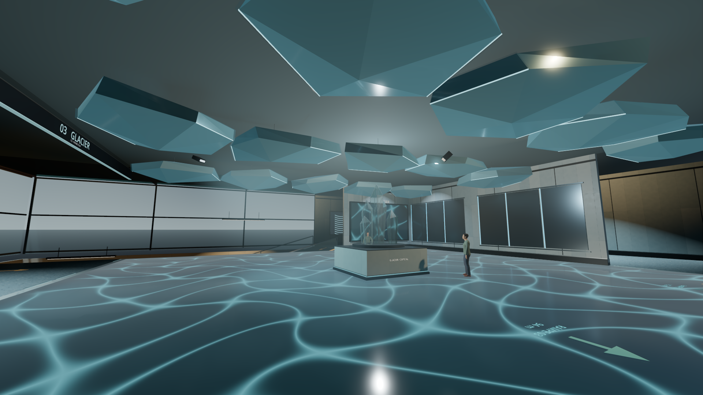
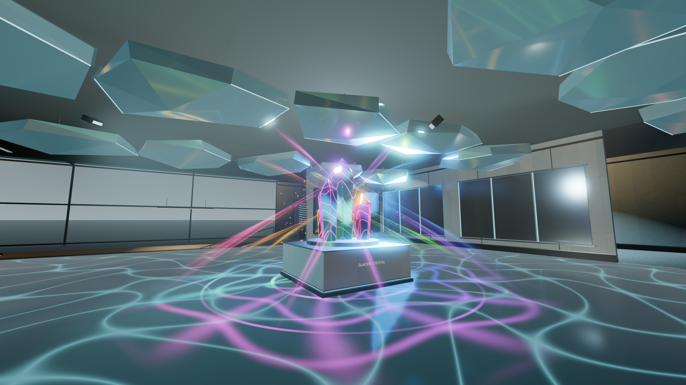

## Aufbau

- `Main.tscn`, `Main.gd`: Zusammensetzen der Komponenten und Forward+-Umgebung.
- `Player.tscn`, `Player.gd`: Spielfigur, Eingaben, Taschenlampe und Minimap.
- `scripts/LabyrinthGenerator.gd`: Geometrie, Kollision, Materialien, Räume, Rampen und Beleuchtung.
- `scripts/LabyrinthLayout.gd`: zentraler Flächenfaktor und Umrechnung zwischen ursprünglichem Entwurfsraster und tatsächlichen Metern. Kollisionskörper werden direkt in den passenden Größen gebaut; die Welt hängt nicht an einem verzerrten Physik-Elternknoten.
- `scripts/GalleryEnvironment.gd`: Tonemapping, indirektes Licht, Nebel und Bildschirm-Effekte.
- `scripts/SurfaceLibrary.gd`, `shaders/architectural_surface.gdshader`, `shaders/gallery_glass.gdshader`: gemeinsam genutzte Stein-, Metall-, Keramik- und Glasmaterialien.
- `scripts/GalleryArchitecture.gd`: Glasdach, Wandpaneele, gerichtete Haupt-/Gegenlichter, Wandbeleuchtung und Reflexionsproben.
- `scripts/ChromaAtrium.gd`, `shaders/chroma_*.gdshader`: kinetisches Atrium mit konservativen Culling-Grenzen für die Shader-Animation.
- `scripts/GlacierRadiance.gd`, `shaders/glacier_*.gdshader`: lokale spektrale Kristallinstallation mit GPU-Partikeln und abgestimmten Echtzeitlichtern.
- `scripts/ExperienceWorlds.gd`, `shaders/experience_*.gdshader`: sechs eigenständige Rauminstallationen und animierte Oberflächen, ohne neue Physikhindernisse.
- `scripts/ExperienceResponse.gd`: dezente lokale Lichtreaktion der Wasser-/Auroraböden auf die Spielerposition, höchstens zehn Parameteraktualisierungen je Sekunde und Material.
- `scripts/GalleryThresholds.gd`: zwölf Portale aus den tatsächlichen Hallen-/Gangverbindungen.
- `scripts/ShowcaseDirector.gd`: Welt-Auswahl, sichere Einstiegspunkte, Vollbild und Raumtitel.
- `scripts/ExhibitSculptures.gd`, `shaders/wall_art.gdshader`: sieben unterschiedliche Exponate und generative Wandbilder.
- `scripts/PlanarGalleryMirror.gd`, `shaders/planar_mirror.gdshader`: perspektivisch berechneter Wandspiegel in Nocturne.
- `scripts/NocturneReflectingFloor.gd`: begrenzter horizontaler Spiegelboden mit derselben Projektionsberechnung, eigener Reichweite und Ausschluss der oberen Etagen.
- `scripts/RampWayfinding.gd`: Wegweiser aus dem tatsächlichen Navigationsgraphen.
- `scripts/GalleryHUD.gd`: Etagen-/Raumanzeige und optionale Bildrate.
- `scripts/VisitorCrowd.gd`, `scripts/LabyrinthVisitor.gd`: 24 Besucher mit reservierten Betrachtungsplätzen, geglätteten Wegen, Bewegung und Animation. Die Anzahl lässt sich über `visitor_count` einstellen.
- `scripts/VisitorItinerary.gd`: persönliche Rundgänge zu Galerien und Atrium; Exponate werden 5–12 Sekunden betrachtet, Ziele bleiben bei einer Neuplanung erhalten.
- `scripts/VisitorTraffic.gd`: Abstandhalten, Ausweichen, Rücksicht auf den Spieler und geregelter Gegenverkehr an Rampen.
- `scripts/VisitorFootIK.gd`: Bodenabfragen, Fuß- und Beinanpassung, begrenzte Beckenabsenkung und Kontaktprüfung anhand der Schuhsohlen.
- `scripts/VisitorTurnMotion.gd`: abwechselnde Drehschritte mit angehobenem Schwungfuß und festem Standfuß.
- `scripts/VisitorAttention.gd`: sanfte, begrenzte Kopfbewegung zum betrachteten Exponat.
- `assets/people/`: vier animierte GLB-Modelle und ihre Texturen; Herkunft und Lizenz stehen in `ASSET-LICENSES.md`.

Architektur liegt auf Render-Layer 1, Decken und Deckeninstallationen auf Layer 2.
Bewegte Besucher verwenden Layer 3 (Bitmaske 4), die echte Spiegelfläche Layer 4
(Bitmaske 8). Die Hauptkamera sieht alle vier Layer (Maske 15), die Minimap nur
Architektur und Besucher (Maske 5). Dadurch bleiben die Decken ausgeblendet und
statische Reflexionsproben enthalten keine eingefrorenen Besucher.
Die Welt besteht aus drei Ebenen im Abstand von sechs Metern; ihre Grundrisse
werden mit einem festen Zufalls-Seed erzeugt. SDFGI, volumetrischer Nebel, Glow,
SSR, SSAO und SSIL benötigen eine für Forward+ geeignete Grafikkarte.

## Besucher und Rechenaufwand

`VisitorCrowd.gd` prüft viermal pro Sekunde die räumliche Entfernung zum Spieler.
Nahe Besucher werden mit voller Bildrate animiert; nur dort laufen Fuß-IK,
Bodenabfragen, Drehschritte und zusätzliche Kopfbewegungen. Pro nahem Besucher
werden zwei Bodenstrahlen je Physikschritt abgefragt. Die kleinen Kontaktbereiche
der Schuhsohlen werden einmal beim Laden erfasst und anschließend für die
Bodenkorrektur verwendet. Ab der mittleren Distanz
werden die Posen nur noch zwölfmal pro Sekunde ausgewertet; die Bewegung und
Kollision bleiben dort flüssig. Weit entfernte Besucher werden ausgeblendet;
Animation, Bewegung, Wegsuche und Kollision werden pausiert. Position, Pose und
Weg bleiben gespeichert. Es gibt beim Aufwecken keinen nachgeholten Zeitsprung.

Die Schwellwerte sind im Crowd-Skript einstellbar: `full_animation_distance`
(20 m), `visibility_distance` (42 m), `distance_hysteresis` (3 m) und
`distant_animation_fps` (12). Mit diesen Werten erfolgt der Wechsel zur
reduzierten Animation beim Entfernen über 23 m, zurück zur vollen Rate unter
17 m. Schlaf beginnt über 45 m, das Aufwecken unter 39 m. Der Abstand wird
dreidimensional gemessen; andere Etagen werden nicht pauschal abgeschaltet,
da sie durch das Atrium sichtbar sein können. Die Minimap verwendet dieselben
Figuren; deshalb entscheidet kein kameraabhängiger Sichtbarkeits-Notifier über
die Simulation. Entfernte pausierte Besucher wandern während der Pause nicht
weiter. Die importierten Mesh-LODs bleiben zusätzlich aktiv.

Zusätzlich teilen gleich große Architekturteile ihre Mesh-Ressourcen.
Lichtwirkungen werden in der Entfernung ausgeblendet. Die Minimap wird mit
20 Bildern pro Sekunde und einer eigenen Umgebung ohne Nebel/SSR/Glow gerendert.
Physikinterpolation glättet die Bewegung der Besucher zwischen Physikschritten;
die Maussteuerung bleibt unmittelbar. 2x MSAA und TAA glätten Kanten und
feine Materialdetails. Wiederholte Wandprofile werden in räumlich begrenzten
MultiMeshes zusammengefasst; sämtliche Richtungspfeile benötigen zusammen zwei
MultiMeshes. Materialien teilen eine gemeinsame prozedurale Stein-Noise-Textur.

Sieben ReflectionProbes erfassen die Galerieräume einmalig; eine zusätzliche
Probe erfasst das Flughafenterminal. SSR ergänzt sichtbare,
bewegte Reflexionen. Die übrigen polierten Wandpaneele verwenden diese lokalen
Reflexionsproben; sie sind keine perspektivisch exakten Planspiegel. Der einzelne
echte Wandspiegel in Nocturne rendert dagegen aus dem gespiegelten Augenpunkt mit
korrekt versetztem Frustum. Sein zusätzliches Bild ist 941×512 Pixel groß und
wird höchstens 24-mal pro Sekunde aktualisiert, nur auf der sichtbaren Vorderseite
innerhalb von rund 22 Metern. Nachweislich durch eine massive Wand vollständig
verdeckte Spiegel werden nicht aktualisiert; Glas oder eine teilweise Verdeckung
stoppen den Capture nicht. Am Rand der Reichweite blendet die Oberfläche in
probe-beleuchtetes Metall über, statt ein eingefrorenes Live-Bild zu zeigen.
Es enthält keine rekursiven Spiegel und keinen zweiten
SSR-/Nebel-/GI-Nachbearbeitungsdurchlauf.
Ein zusätzlicher, 12 × 12 m großer Spiegeleinsatz im Nocturne-Boden reflektiert
Sternendecke, Skulptur und Besucher mit korrekter Perspektive. Sein Capture ist
640 × 640 Pixel groß, auf 20 Hz und 16 m Entfernung begrenzt. Von den oberen
Hallen verhindern die tatsächlich geschlossenen Deckenflächen unnötige Captures
beider Spiegel. Sichtstrahlen außerhalb dieser Deckenfläche bleiben zulässig.
Beide Planspiegel schließen
Spiegelflächen aus ihren Captures aus, damit keine rekursiven Renderketten entstehen.
Die einmaligen Cubemaps bleiben statische Annäherungen. Bewegte Raumkunst wird
über SSR und den echten Planspiegel dynamisch reflektiert, soweit sie dort sichtbar
ist. Die Wassereffekte und Magmaadern sind gestaltete Shader-Installationen;
sie simulieren keine physikalische Flüssigkeit. Die Glasbrechung verwendet den
opaken Bildhintergrund und kann keine verdeckten oder transparenten Hintergründe rekonstruieren.
Eine allgemeine FPS-Garantie lässt sich daraus nicht ableiten.

## Verhalten und Grenzen

Normale Kurven werden ohne vollständigen Halt durchlaufen. Die geglätteten
Wegsegmente werden mit der Kollisionskapsel auf freie Durchgänge geprüft.
An engen Rampen und vor Kehrtwenden bewegen sich die Besucher vorsichtiger.
Auf der tatsächlichen Steigung bleiben Seitenschritte gesperrt. Auf den breiten,
flachen Rampenpodesten dürfen wartende Besucher dagegen kollisionsgeprüft Platz
machen, damit sie den Gegenverkehr nicht am Ausgang festhalten.
Das Animationstempo folgt der tatsächlichen Gehgeschwindigkeit einschließlich
der Steigung auf Rampen. Exponate
werden im Stand angesehen. Betrachtungsplätze werden reserviert, damit nicht
alle Besucher denselben Zielpunkt belegen. Die Reservierung erfolgt erst in
der Nähe des Exponats; bei voller Belegung geht der Besucher nach einer kurzen
Wartezeit zum nächsten Exponat. Dadurch blockieren lange Anreisen keine Plätze.

Die Figuren verwenden vorhandene Geh- und Standanimationen, ergänzt durch
prozedurale Drehschritte, Kopfbewegungen und Fuß-IK. Beim Drehen im Stand setzen
sie die Füße abwechselnd um. Auf Rampen passen sich Beine, Schuhneigung und
Becken an die Bodenhöhe an; gesetzte Füße werden während der Kontaktphase in
Weltkoordinaten gehalten. Eine zusätzliche Prüfung der verformten Schuhsohle
korrigiert Einsinken, das allein anhand der Fußknochen nicht erkennbar wäre.
Die Anpassung berücksichtigt die unabhängigen Fußwurzelknochen aller vier Modelle.

Die Ergänzungen sind prozedural, keine neu aufgenommenen Motion-Capture-Clips.
Die isolierten Fußtests prüfen ebenen Boden und ±18,4° Steigung, einschließlich
Querstellung. Die verlängerten Projektrampen sind mit etwa ±15,23° flacher und
werden zusätzlich mit echten Besucher-Traversierungen geprüft. Die begrenzte IK ist keine allgemeine
Lösung für Sprünge, hohe Treppenstufen oder beliebig unebenes Gelände.

Reproduzierbare Prüfungen stehen unter `Tests/`: Besucher-Rundgänge,
Abstandssteuerung, Rampen und Gegenverkehr. Beispielsweise:
`godot --headless --path . --fixed-fps 60 --script Tests/VisitorTourRegression.gd`.
Dieser Test simuliert fünf Minuten mit 24 aktiven Besuchern und prüft
Zielankünfte, Betrachtungspausen, Blickrichtung, Stürze und lange Stillstände.

Zusätzliche Tests prüfen Beinlängen und Knöchelkontakt (`VisitorFootIKRegression.gd`),
die tatsächlich verformten Schuhsohlen (`VisitorSoleRegression.gd`), feste
Fußkontakte (`VisitorPlantRegression.gd`), Drehschritte (`VisitorTurnMotionRegression.gd`)
und Kopfbewegungen (`VisitorAttentionRegression.gd`). Beim geprüften Stand
bestanden 2.400 Sohlen-Snapshots aller vier Modelle ohne gemessene Bodenpenetration;
der größte Abstand des unteren Sohlenpunkts betrug 1,35 cm. Die Renderprobe
`tools/visitor_pose_probe.gd` prüft zusätzlich das Zusammenspiel und das Abschalten
der zusätzlichen Berechnungen in mittlerer und großer Entfernung.

## Grafik- und Wegeprüfung

- `Tests/WayfindingRegression.gd`: 439 Routen gegen unabhängig berechnete kürzeste Wege, Pfeilrichtungen, Wandfreiheit und Rampen-Bodenkontakt.
- `Tests/ExpandedLayoutRegression.gd`: tatsächliche Mesh-Grundfläche, Gebäudeabmessungen, Rampenprofil, Bodenunterstützung aller Graphpunkte sowie unveränderte Spielergröße und Geschwindigkeit.
- `Tests/ShowcaseRegression.gd`: echte Welt-Sprünge, Kapsel-/Bodenprüfungen, Minimap, vollständige Rotationshülle der Atriumsegel sowie Spiegel-Verdeckung/Fallback.
- `Tests/ExperienceWorldsRegression.gd`: Geometriehöhen, geglättete Normalen, Wandunterstützung und Render-Layer aller sechs Installationen. Ein Lauf mit dem echten Renderer vergleicht zusätzlich alle 1.336 MultiMesh-Transforms mit ihren gebauten Werten; der Headless-Dummy behält diese GPU-Daten nicht.
- `Tests/GalleryArchitectureRegression.gd`: tatsächliche Render-Layer, Minimap-Clipping, gültige Geometrie und Kollisionsfreiheit entlang der Navigationskanten.
- `Tests/PlanarMirrorRegression.gd`: Off-Axis-Projektion, reflektierte Sichtstrahlen, Clipping und begrenzte Aktualisierung.
- `Tests/VisitorRampLandingRegression.gd`: vier gezielt erzwungene Konflikte zwischen Warteschlange und Rampenausfahrt, einschließlich Verbot von Seitenschritten auf der Steigung.
- `tools/gallery_review_probe.gd`: echte Forward+-Bilder vom Startpunkt, Atrium und allen sechs Hallen unter `user://gallery_*.png`.
- `tools/showcase_review.gd`: aktuelle Welt-Auswahl, acht Forward+-Raumansichten und Menü; mit `-- 0 3` lassen sich einzelne Bereiche prüfen.
- `tools/showcase_benchmark.gd`: alle acht Welten mit normalem HUD, Minimap und Besucher-LOD; je 2,5 Sekunden Aufwärmphase und drei Sekunden Messung. JSON-Ergebnisse unter `user://showcase_benchmark_<Breite>x<Höhe>.json`.
- `tools/planar_mirror_probe.gd`: seitliche Spiegelansichten mit einem unabhängigen Farb-/Projektionsvergleich.
- `tools/gallery_benchmark.gd`: vier Ansichten bei Projektauflösung, ohne VSync, mit Aufwärmphase, Median und 95. Perzentil der tatsächlich gerenderten Bildintervalle. Währenddessen keine anderen Lasttests starten.

Messung der vollständigen Erlebniswelten vom 29.10.2026 **vor der Glacier-
Prismenresonanz-Erweiterung**, auf der vorhandenen
RTX 4070, Godot 4.7.2, **1920×1080**, ohne VSync und ohne parallele Testprozesse.
Die normale Besucher-LOD, HUD und Minimap blieben aktiv. Pro Ansicht wurden
nach 2,5 Sekunden Aufwärmen drei Sekunden gemessen. Ergebnisse sind Stichproben
dieser Ansichten, keine Mindest-FPS-Zusage:

| Ansicht | Median pro Bild | 95. Perzentil | FPS aus dem Median |
| --- | ---: | ---: | ---: |
| Atrium | 6,02 ms | 8,00 ms | 166 |
| Solar | 6,14 ms | 8,64 ms | 163 |
| Nocturne mit Wand- und Bodenspiegel | 4,72 ms | 7,27 ms | 212 |
| Glacier | 5,84 ms | 7,20 ms | 171 |
| Spectrum | 6,10 ms | 8,00 ms | 164 |
| Ember | 4,97 ms | 6,17 ms | 201 |
| Afterglow | 5,71 ms | 8,03 ms | 175 |

Die Capture-Zähler bestätigen in der Nocturne-Messung **72 Wand- und 60
Bodenspiegelbilder in drei Sekunden**. In den anderen sechs Messansichten
blieben beide Zähler bei null. Das schließt insbesondere die Räume über
Nocturne ein: Deren geschlossene Geschossdecke verhindert unnötiges Spiegelrendern.
Rohdaten stehen in `doc/showcase/benchmark-1920x1080.json`; echte, unbearbeitete
1080p-Renderaufnahmen aller Welten und der Auswahl ebenfalls in `doc/showcase/`.
Dieser Ordner ist über `.gdignore` vom Asset-Import ausgeschlossen.

Der Abschlusscheck bestand 3.266 Showcase-Prüfungen einschließlich echter
Tasteneingaben und sieben sicheren Weltwechseln. Die Installationsprüfung mit
aktivem Vulkan-Renderer bestand 179.940 Prüfungen einschließlich des Readbacks
aller 1.336 gebauten Instanztransformationen. Die unabhängige Architekturprüfung
bestand 10.636 Kapselpositionen entlang des Wegenetzes; alle 439 geprüften
Rampenrouten und die vier tatsächlichen Rampendurchläufe blieben fehlerfrei.

Der letzte Rundgangstest der Besucherlogik im vergrößerten Grundriss mit 24 Besuchern über fünf Simulationsminuten
bestand mit 91 Zielankünften, 89 geprüften Betrachtungspausen und keinem
Rückwärtslaufen. Der längste ungeplante Stillstand außerhalb einer Rampenwarteschlange
betrug 6,33 Sekunden. Die zusätzliche Rampen-Landungsprüfung bestand alle vier
erzwungenen Konfliktfälle.

Bekannte Einschränkung der installierten Godot-Version: Beim Beenden nach einem
ReflectionProbe-Capture erscheint eine Warnung über sieben Texture-RIDs.
`tools/reflection_shutdown_probe.gd` reproduziert sie bereits in einer isolierten
Szene mit einer einzigen ReflectionProbe, auch nach expliziter Freigabe und
Render-Synchronisation. Ohne ReflectionProbe tritt sie dort nicht auf. Die Warnung
wird nicht unterdrückt; sie ist von Skriptfehlern und fehlgeschlagenen Tests zu unterscheiden.
