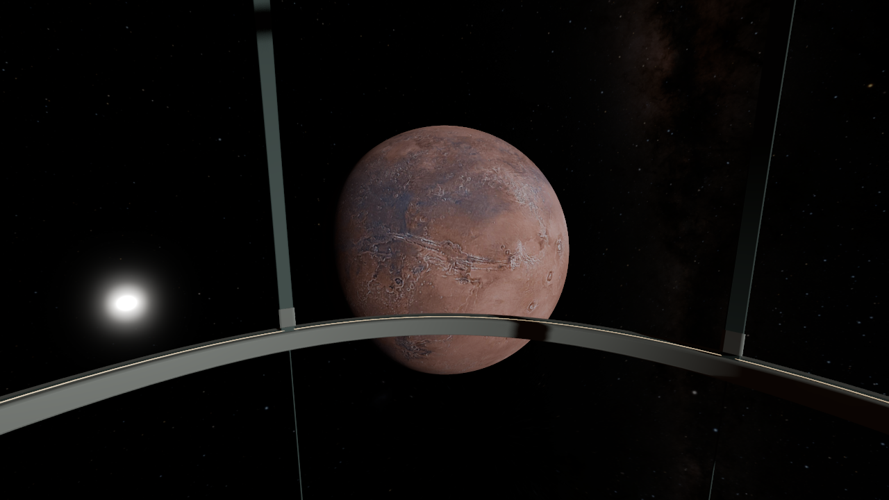
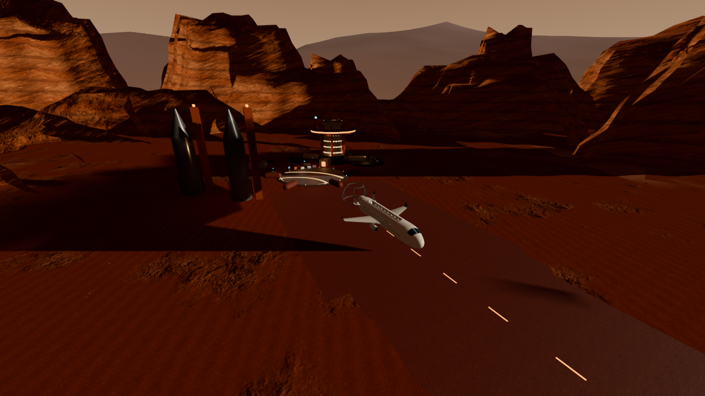

# Marsflug: Landung und Weltraumansicht

Stand: 31. Oktober 2026. Geprüft mit Godot `4.7.2.stable.official.ed1daf0bf`,
Forward+ / Vulkan auf einer NVIDIA GeForce RTX 4070, 1280 × 720 Pixel.

Der Marsflug verwendete zuvor den Mondlandeversatz. Die Kabine stand dadurch
ungefähr bei `(100, 6.6, -190)` im lokalen Marsbasis-Koordinatensystem, außerhalb
der freien Fläche und innerhalb der Berge. Sie parkt nun bei `(0, 3.2, -70)`;
die Unterkanten der Reifen liegen auf dem Boden. Anflug, Ausrollen, Abflug und
vorzeitige Rückkehr halten den vollständigen Flugzeugkörper von den Gebäuden
und Felsmeshes frei. Ein gemeinsamer Geländebezug verhindert schwebende Mesas.

Im normalen Flug erscheinen keine flachen Weltraum-Archivtafeln mehr. Erde und
Mars sind beleuchtete Kugeln mit fotografischen Oberflächenkarten, getrennten
Blickrichtungen, dunklen Nachtseiten und zurückhaltenden Atmosphärensäumen.
Der NASA-Kataloghimmel bleibt statisch; seine Helligkeit sinkt bei großem,
beleuchtetem Planetenscheibchen. Die fotografischen Archivdateien samt Credits
bleiben erhalten und lassen sich im Werkzeug `tools/mars_review.gd` ausdrücklich
aktivieren. Die normale Flugsteuerung aktiviert sie nicht.

Die Aufnahmen unten stammen aus der echten Spielszene mit dem Produktionsshader.
Die Übersicht verwendet eine zusätzliche Kameraposition, um das geparkte
Flugzeug und die Bergunterkanten sehen zu können. Kein KI-Bild und keine Montage.




## Verifikation

| Prüfung | Ergebnis |
| --- | --- |
| `MarsLandingRegression.gd` | 612654 Prüfungen, 0 Fehler |
| `MarsCelestialRegression.gd` | 2433 Prüfungen, 0 Fehler |
| `MarsObservatoryRegression.gd` | 233 Prüfungen, 0 Fehler |
| `MarsExpeditionRegression.gd` | 59 Prüfungen, 0 Fehler |
| `LunarFlightRegression.gd` | 35350 Prüfungen, 0 Fehler |
| `LunarSurfaceWalkRegression.gd` | 74 Prüfungen, 0 Fehler |
| Editor-Import und Skriptprüfung | erfolgreich |
| `tools/mars_flight_review.gd` | 10 Forward+-Ansichten, keine Shaderfehler |

Die Landungsprüfung verwendet die tatsächlichen Mesh-Grenzen von Flugzeug,
Gebäuden und Felsen sowie die eingebundene Höhenkarte. Sie prüft auch die
Übergänge und Abbruchpfade. Die Mondflugprüfung wurde an die bestehende
Bedienung angepasst: Escape gibt die Maus frei; B verlässt die Basis.

Aufnahmen erneut erzeugen:

```text
godot --path . --resolution 1280x720 --script res://tools/mars_flight_review.gd
```

Eine einzelne Ansicht auswählen: `-- --only=earth_view`. PNG-Dateien werden
in Godots `user://`-Verzeichnis geschrieben. Die Regressionen laufen mit
`godot --headless --path . --script res://Tests/<Testname>.gd`.

## Grenzen

Reisezeit, Entfernung und Kameraroute bleiben für den Erlebnisflug verkürzt.
Die Planetenrichtungen sind inszeniert, keine datumsbezogene Ephemeride.
Die Mars-Höhenkarten sind aus Bildhelligkeit und Farbe abgeleitetes Relief,
keine vermessenen MOLA-Höhen; der Standort der Kolonie ist fiktiv und abgeflacht.
Der fotografische Ursprung der Oberflächenkarten macht die dargestellte
3D-Landschaft nicht zu einer originalgetreuen Rekonstruktion.
